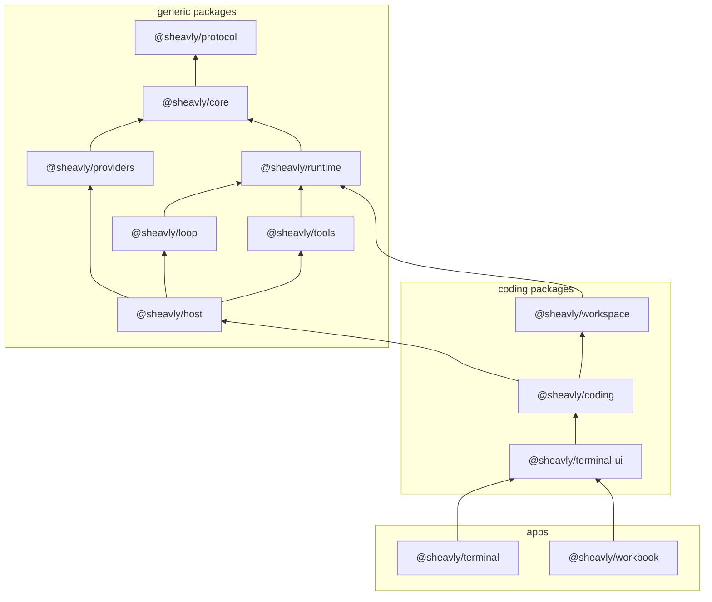

# Overview

## What it is for

In the author's words: "a typescript loop with the possibility of UI in the future that runs a
coding agent and handles everything from tool calls, reading agents.md files, handling sub
agents, background tasks." It works with any model provider, and the loop must "wait for tools,
wait for agent, wait for user, interrupt agent by user."

The harness owns the agent loop and everything it emits; a UI (or the CLI demo) only renders
events. That split decides where new work goes: if a UI would need it, the harness emits it.

**Backend only.** The harness renders nothing, prompts no one and reads no terminal input. What a
user must see or decide is a typed event or a registry request (`AgentEvent`, `SessionUpdate`,
`ApprovalUpdate`) that a UI handles its own way. UI code is written only when an issue asks for a
UI, and only in an app (`apps/*`); the shared `harness/no-terminal-io` rule fails terminal I/O in
every package, and `baseConfig` reads which workspaces are apps from where they are. Cursor injects
this rule from the project skill the first time a chat edits harness source.

## Layers

Imports only point down. ESLint enforces it (`harness/imports`): the workspace graph is read from
each workspace's `package.json` (its dependencies, and its `sheavly.domain`), and whether it is a
package or an app from its folder. A workspace without a domain, or an edge the graph doesn't
allow, fails lint.

Libraries live in `packages/`, front ends in `apps/`. Each arrow points from a workspace to one it
depends on, and a workspace may import everything it reaches. Generic workspaces never depend on
coding ones, nothing depends on an app, and `@sheavly/testing` and `@sheavly/eslint-config` are dev
dependencies only (not drawn). The diagram is generated from each workspace's `package.json`
(`npm run graph`), and the layout check fails when it is out of date.

<!-- graph:start (generated by `npm run graph`; do not edit) -->



<!-- graph:end -->

A new workspace comes from `npm run new` (README, "Workspace layout"); the project skill's
"Where code goes" says which one something belongs in.

| Where                       | What lives there                                                                                                                                                                                                                                                            |
| --------------------------- | --------------------------------------------------------------------------------------------------------------------------------------------------------------------------------------------------------------------------------------------------------------------------- |
| `packages/protocol/src/`    | `@sheavly/protocol`, the wire contract a UI talks to, as zod schemas: `message/`, `session/`, `task/`, `approval/`, `event/`; its JSON Schema (`contract/`). zod only                                                                                                       |
| `packages/core/src/`        | Code contracts only: `message/` (what a provider streams), `provider/`, `tool/`, `adapter/`, `hook/`                                                                                                                                                                        |
| `packages/providers/src/`   | `@sheavly/providers`, model backends: protocol layers (`responses/`), backends on them (`openai/`, `azure/`), adapter registry, `ProviderSwitch`                                                                                                                            |
| `packages/runtime/src/`     | `@sheavly/runtime`, the generic services a run uses: `sessions/`, `tasks/` (background tasks), `approvals/`, and their errors; `errors/errors.utils.ts`; fakes for them in `testing/`                                                                                       |
| `packages/workspace/src/`   | `@sheavly/workspace` (coding): the project on disk. `workspace/` (path confinement), `file-locks/`, `process/` (the process runner), `trust/`, `project-hooks/` (`.sheavly/`), `agents-md/`, their errors, and the fakes `useTempWorkspace` and `useFileLocks` (`testing/`) |
| `packages/tools/src/`       | `@sheavly/tools`, the generic tools: `sub-agent/` (`start_agent`, `message_agent`, `report_status`), `tasks/` (`task_status`, `cancel_task`)                                                                                                                                |
| `packages/loop/src/`        | `@sheavly/loop`: `streamAgent` / `runAgent`, events, the ordered queue, abort helpers, hooks; `HookError` and `StreamEndedError` (`errors/`)                                                                                                                                |
| `packages/host/src/`        | `@sheavly/host`: wiring a run (`createHarness`) and the model from an environment the app passes in (`providerFromEnv(process.env)`). No UI, and no imports from a front end                                                                                                |
| `packages/coding/src/`      | `@sheavly/coding` (coding): the coding tools (`files/`, `read-file/`, `write-file/`, `edit-file/`, `run-command/`) and the preset (`preset/`: `createCodingHarness`, `trustStoreFromEnv`); `CommandRefusedError` (`errors/`)                                                |
| `packages/terminal-ui/src/` | `@sheavly/terminal-ui` (coding): the terminal `Renderer` the demo and the workbook print events with. It writes through a function it is given and reads no input                                                                                                           |
| `apps/terminal/`            | `@sheavly/terminal`, front end: the demo, a CLI that reads env, wires a run with `createCodingHarness` and prints events (`npm run demo`)                                                                                                                                   |
| `apps/workbook/`            | `@sheavly/workbook`, front end: a stateful CLI with stored prompts, saved runs, continue, step and diff (`npm run workbook`; its data is in `workbook/`)                                                                                                                    |
| `apps/vscode/`              | A README for the VS Code extension, not yet a workspace                                                                                                                                                                                                                     |

Every file is `<name>.<kind>.ts` (`types`, `constants`, `utils`, `validator`, `helper`, `service`,
`tool`, ...): pure code is `utils`, zod schemas for external input and their `parse*` functions
are `validator`, stateless code that does I/O is `helper`, and only code that owns state, a
class, is `service`. See the project skill in `.cursor/skills/working-in-sheavly-harness/` for
the full conventions.

## Entry points: a generic harness, and coding on top

A run is wired in one of two ways:

| Entry point                               | For                                                                  | What it wires                                                                                                                                                             |
| ----------------------------------------- | -------------------------------------------------------------------- | ------------------------------------------------------------------------------------------------------------------------------------------------------------------------- |
| `createHarness` (`@sheavly/host`)         | Any LLM project: text parsing and extraction, chat wrappers, no repo | The caller's `tools` and `hooks`, plus the task tools, `start_agent` and `message_agent`; the session, task and approval registries. Opens no workspace and reads no file |
| `createCodingHarness` (`@sheavly/coding`) | A coding agent in a repo (the demo, the workbook)                    | Opens the `Workspace`, checks trust and loads the `.sheavly/` hooks, adds the AGENTS.md hook, the file tools and `run_command`, then calls `createHarness` with them      |

```ts
const harness = createHarness({ provider, title: prompt, tools: [extractTool] });

for await (const event of streamAgent({
  provider: harness.provider,
  tools: harness.tools,
  hooks: harness.hooks,
  messages: [{ role: 'user', content: prompt }],
  tasks: harness.tasks,
  session: { registry: harness.sessions, ref: harness.mainSession },
}))
  render(event);
```

Sub-agents get only what `subAgents` lists (`tools`, `hooks`, `instructions`); the coding preset
gives them the file tools and the AGENTS.md hook. Pass `tasks` or `approvals` in when a tool needs
the registry before the harness exists (as `run_command` does).

The rule (from [#74](https://github.com/Sheavly/code/issues/74)): generic code never needs a project on disk or a coding tool.
The loop, the generic runtime services (`sessions`, `tasks`, `approvals`), the generic tools
(`sub-agent`, `tasks`) and `createHarness` import none of the workspace-bound services
(`workspace`, `file-locks`, `process`, `trust`, `project-hooks`, `agents-md`) or the coding tools
(`read-file`, `write-file`, `edit-file`, `files`, `run-command`), and neither do their tests. Only
the coding preset reaches them, which is why each lives in a package of its own and the generic
ones never depend on the coding ones.

## Packages

Workspaces (`packages/*`, `apps/*`) are **built**: each compiles its own `dist/` (`.js`, `.d.ts`,
source maps) with `tsc -b`, and `npm run build` runs each workspace's build through turbo after
the ones it imports (`@sheavly/protocol`, then `@sheavly/core`, … then the apps).

A package's `exports` is its public API: one entry per module other workspaces may import, each
with its source, types and build targets, and never a wildcard over `src/` (its fakes,
`./testing/*`, from source only, for tests):

```json
"./tool/tool.utils": {
  "@sheavly/source": "./src/tool/tool.utils.ts",
  "types": "./dist/tool/tool.utils.d.ts",
  "default": "./dist/tool/tool.utils.js"
}
```

Anything not listed is internal: `harness/imports` fails an import of it, and the layout check fails
a wildcard, a misshapen entry or one naming no file. `npm run export -- @sheavly/<pkg>/<module>/<file>`
adds an entry, in review; an app exports nothing.

| Where it runs            | Reads                                      | How                                                                                   |
| ------------------------ | ------------------------------------------ | ------------------------------------------------------------------------------------- |
| Dev (`demo`, `workbook`) | source                                     | `tsx --conditions=@sheavly/source`                                                    |
| Tests                    | source, with no build step before `vitest` | the condition in `vitest.config.ts`                                                   |
| Typecheck, lint          | source                                     | `customConditions` in `tsconfig.base.json`                                            |
| Production               | `dist/`                                    | `npm run build`, then plain `node` on an app's `dist/` (`apps/terminal/dist/demo.js`) |

Each package's `tsconfig.build.json` clears the condition, so a build only ever links against
another package's built output, and leaves `__tests__/` and `testing/` out: test fakes are
available from source only and never ship. `@sheavly/eslint-config` is plain JavaScript that only
ESLint loads, so it isn't built.

Why built, not source only: a harness others embed has to run on plain Node without a TypeScript
loader. Why `tsc -b`, not a bundler or a task runner: the source already uses `.js` imports and
`nodenext`, so `tsc`'s output is what Node runs, one file per exported subpath. A bundler (Vite
library mode, tsup) would merge those files and needs a plugin for declarations. Turborepo only
orders and caches each workspace's `build` script on top of it.

## The wire contract

`@sheavly/protocol` is the bottom layer: everything the harness sends a UI or accepts from one
(`AgentEvent`, `SessionUpdate`, `ApprovalUpdate`, `ApprovalResponse` and the types inside them),
defined once as zod schemas. Every type is `z.infer` of its schema, so the TypeScript types and
what goes over the wire can't drift. It depends on zod only; its `eslint.config.js` keeps the
other workspace packages out.

- A TypeScript UI imports the types (`@sheavly/protocol/event/event.types`) and can parse what it
  receives with the schemas (`event.validator`).
- Any other client reads `packages/protocol/contract.schema.json`, the whole contract as one JSON
  Schema (draft 2020-12, every type under `$defs`). `npm run schema -w @sheavly/protocol` writes it
  from the schemas, and a test fails when the committed file is out of date.
- A loop test (`wire-contract.test.ts`) parses every event and session update of a scripted run
  against its schema.
- Only the wire contract lives there. What a provider streams (`StreamEvent`, `StopReason`) and
  the code contracts (`Tool`, `Hook`, `Adapter`) stay in `@sheavly/core`, and the queue's generic
  `Sequenced<T>` in the loop.

## The provider contract

A provider (`packages/core/src/provider/`) is one method, `stream(request)`, returning
`StreamEvent`s. Every model call gets a fresh `ProviderRequest`:

| Field          | What it is                                                                                                                                                |
| -------------- | --------------------------------------------------------------------------------------------------------------------------------------------------------- |
| `instructions` | System instructions for this call, or none: the run's `instructions` option, then what `beforeTurn` hooks added (e.g. AGENTS.md), joined with blank lines |
| `messages`     | The conversation history (a copy): user, assistant and tool messages                                                                                      |
| `tools`        | The tool definitions (name, description, JSON schema)                                                                                                     |
| `signal`       | Aborts the call                                                                                                                                           |

`instructions` are rebuilt each turn and never stored in `messages`, so they can change between
turns (an edited AGENTS.md) without touching history. The Responses client sends them as the
API's `instructions` field.

## One run

`streamAgent(options)` returns an async iterable of events, each with a gap-free `seq`:

1. `sessionStart` hooks run (they may add context).
2. Each turn: finished background tasks are reported, messages sent to the session meanwhile
   (steering) are added, `beforeTurn` hooks run (they may add
   context and this turn's system instructions), then the model is called. Text and reasoning
   stream out as they arrive.
3. Tool calls start the moment the model asks for them, each wrapped by `aroundToolCall` hooks.
   Their results are released after the turn ends, in call order (`tool_batch`, `tool_result`).
   A `tool_result` can carry `artifacts`, the tool's data for a UI (a file write's before and
   after, which lines a read covered); the model sees only the text, a UI renders these.
4. `afterTurn` hooks run. If the model called tools, the next turn starts; otherwise the run ends
   (or waits for a background task, with `waitForTasks`).
5. `done` is always last and carries the full history, valid to continue from, and the run's
   session (every run is a session with an id; see [sessions.md](sessions.md)).

Aborting the signal stops cleanly at any point: unfinished tools get an "interrupted" result, so
history stays valid. If the run fails, `onError` hooks are told and the error is rethrown; an
`onError` handler that fails is reported as a `hook_failed` event, never in place of that error. A
model call that fails after it started tools (a cut-off stream, an error event) first stops those
tools and emits their results, so every `tool_call_started` is answered, then fails the run.

## Trust model

The harness is for **trusted local repositories**. It checks what the agent asks for, but it is
not an OS sandbox: nothing isolates the processes it runs from the rest of the machine. For a repo
you don't trust, run the harness in a container or VM.

What `Workspace` (`@sheavly/workspace/workspace/`) and the tools enforce is **path confinement**:

- The file tools resolve every path inside the workspace root and refuse anything that ends up
  outside it (`../`, absolute paths, symlinks out). `.env` files are refused by name, and writes
  inside `.git` are refused ([tools.md](tools.md#file-tools)).
- `run_command` runs only allow-listed commands without shell syntax, checks their arguments with
  the same path rules, asks for approval when one reaches outside or can name a `.env` file, and
  sets git config that blocks most ways a repo can make git run programs
  ([tools.md](tools.md#commands)).
- Commands get the harness's env without the variables whose names look like secrets (`KEY`,
  `SECRET`, `TOKEN`, `PASSWORD`, `CREDENTIAL`). This is a filter on names, not complete scrubbing:
  a secret in a value under another name (`DATABASE_URL`), `SSH_AUTH_SOCK` and credential files
  the user can read (`~/.npmrc`, `~/.aws/credentials`) still reach commands.

What runs with the user's full rights, outside those checks:

- **Allowed commands, and anything they execute.** `npm test` runs the repo's npm scripts, test
  config and test files; those can read, write or send anything the user can. Argument checks
  don't reach inside them. Isolating commands is [#4](https://github.com/Sheavly/code/issues/4).
- **Any command, with `skipAllowList`.** With it set (`RUN_COMMAND_SKIP_ALLOW_LIST=true` in the
  demo), `run_command` runs whatever shell command the model writes, with no allow list, argument
  checks or approvals.
- **Git filter drivers a repo brings.** A filter defined in a cloned repo's `.git/config` and
  named in a committed `.gitattributes` still runs when an allowed `git status` or `git diff`
  does; on git older than 2.42, so does one an edited `.gitattributes` turns on.
- **`.sheavly/` project hooks.** They run inside the harness process, with its rights and its env
  (keys included). They load only in a workspace the user trusted, and only until `.sheavly/`
  changes ([hooks.md](hooks.md#workspace-trust)), but once loaded nothing confines what they do.

## Errors

The harness fails loudly, and ESLint enforces it in every workspace and on `.cursor/hooks/`:

- `harness/no-silent-catch`: a `catch` either rethrows or checks what it caught (an error code, a
  class) and handles only what it expects, so no failure turns silently into a default.
- `harness/no-raw-error`: source never creates a plain `Error`. Every error is a typed class,
  with a `name` and the fields to act on, keeping the original as `cause`, so a caller catches it
  by class instead of by message. Tests, fakes and root `scripts/` are exempt.

Each area keeps its own classes, since the layers can't all import one another:

| Where                            | Classes                                                                                 |
| -------------------------------- | --------------------------------------------------------------------------------------- |
| `packages/core/src/errors/`      | `DefinitionError`: a tool or hook defined wrong; `ToolCallError`: a tool refused a call |
| `packages/loop/src/errors/`      | `HookError`, `StreamEndedError`                                                         |
| `packages/providers/src/errors/` | `AdapterError`, `ResponsesApiError`, `ProviderSwitchError`                              |
| `packages/runtime/src/errors/`   | `SessionError`, `ApprovalRequestError`, `ApprovalListenerError`; `errors.utils.ts`      |
| `packages/workspace/src/errors/` | The project on disk: workspace, processes, trust, project hooks, AGENTS.md (below)      |
| `packages/coding/src/errors/`    | `CommandRefusedError`                                                                   |
| `apps/workbook/src/errors/`      | The workbook's (below)                                                                  |
| `.cursor/hooks/hooks.errors.mjs` | `HookStateError`, `ProjectReadError`, `GuardCrashError`                                 |

| Class                                  | Package              | Thrown when                                                                 |
| -------------------------------------- | -------------------- | --------------------------------------------------------------------------- |
| `WorkspaceError`                       | `@sheavly/workspace` | A path is outside the workspace, or a broken symlink                        |
| `PathCheckError` (`path`, `code`)      | `@sheavly/workspace` | A path couldn't be checked at all (`EACCES`, `ELOOP`); never "missing"      |
| `ProjectHooksError`                    | `@sheavly/workspace` | `.sheavly/` hooks can't be read, validated or loaded                        |
| `ProcessKillError` (`pid`, `code`)     | `@sheavly/workspace` | A command's process group couldn't be stopped; it may still be running      |
| `ProcessInterruptedError`              | `@sheavly/workspace` | The run was interrupted before a command started                            |
| `AgentsMdError` (`root`, `cwd`)        | `@sheavly/workspace` | The working directory is outside the project root                           |
| `TrustStoreError` (`file`)             | `@sheavly/workspace` | The workspace trust store exists but can't be read, parsed or written       |
| `ApprovalRequestError` (`reason`)      | `@sheavly/runtime`   | No one listens for approvals, or an answer names no waiting request         |
| `ApprovalListenerError` (`update`)     | `@sheavly/runtime`   | An approval subscriber threw                                                |
| `SessionError` (`reason`, `sessionId`) | `@sheavly/runtime`   | A session operation was refused (unknown, ended, too deep, not an ancestor) |
| `CommandRefusedError` (`reason`)       | `@sheavly/coding`    | A command needed approval nobody could give, or the user skipped it         |
| `WorkbookStoreError` (`file`)          | `@sheavly/workbook`  | A workbook file exists but can't be read or parsed                          |
| `WorkbookNotFoundError` (`wanted`)     | `@sheavly/workbook`  | A stored prompt, run or saved conversation isn't there                      |
| `WorkbookPromptError` (`prompt`)       | `@sheavly/workbook`  | A stored prompt file has bad front matter                                   |

`@sheavly/runtime/errors/errors.utils` has `errorMessage`, `errorCode` and `isMissingPath`
(`ENOENT` / `ENOTDIR` only).

## Where the next work goes

- Something sent to or accepted from a UI (an event, an update, an answer): a zod schema in
  `packages/protocol/src/<module>/<module>.validator.ts`, its type inferred in
  `<module>.types.ts`; then `npm run schema -w @sheavly/protocol` (see "The wire contract").
- A code contract other packages depend on (a tool, a hook, a provider): `packages/core/src/<module>/`.
- A model backend: `packages/providers/src/<name>/<name>.adapter.ts`, with `defineResponsesAdapter`
  for a Responses API backend; another protocol gets its own folder next to `responses/` (see
  [the package README](../packages/providers/README.md)).
- A tool: a generic one in `packages/tools/src/<name>/`, one that touches files or runs commands in `packages/coding/src/<name>/` (see [tools.md](tools.md)).
- A new hook point: an optional handler on `Hook` (see [hooks.md](hooks.md)).
- Something a UI must show: a new event in `agentEventBodySchema`
  (`packages/protocol/src/event/event.validator.ts`).
